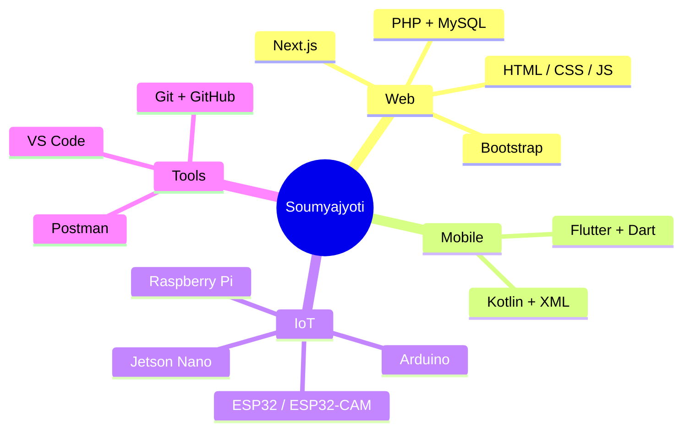
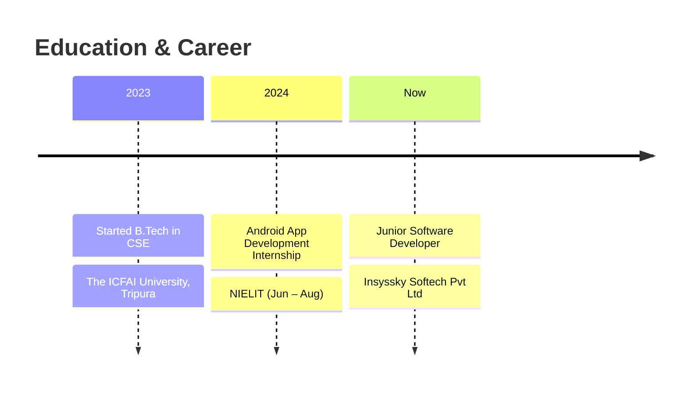

<div align="center">


<br/>

<a href="https://www.linkedin.com/in/soumyajyoti-banik-b9a345313"></a>
<a href="mailto:soumyajyotibanik07@gmail.com"></a>
<a href="https://github.com/emphaticHarp"></a>

<br/>


</div>


## 🧑‍💻 &nbsp;About Me

<table>
<tr>
<td width="58%" valign="top">

```ts
const soumyajyoti = {
  role:       "Junior Software Developer @ Insyssky Softech Pvt Ltd",
  education:  "B.Tech CSE @ The ICFAI University, Tripura (2023 — 2026)",
  focus:      ["Web Development", "IoT Systems", "Mobile Apps"],
  builds:     ["Web apps", "Embedded systems", "Android & Flutter apps"],
  philosophy: "Efficient, scalable, user-friendly — pick all three.",
  status:     "Open to collaborations & research 🚀",
};
```

</td>
<td width="42%" valign="top" align="center">


</td>
</tr>
</table>


## 💼 &nbsp;Experience

<table>
<tr>
<td width="8%" align="center">💻</td>
<td width="92%">

**Junior Software Developer** &nbsp;·&nbsp; Insyssky Softech Pvt Ltd


</td>
</tr>
<tr>
<td width="8%" align="center">📱</td>
<td width="92%">

**Internship Training, Android App Development** &nbsp;·&nbsp; NIELIT &nbsp;·&nbsp; *Jun 2024 – Aug 2024*
Android Studio, XML, Java

</td>
</tr>
</table>


## 🛠️ &nbsp;Tech Stack

<div align="center">

<br/>
<br/>


<br/>


</div>




## 🌱 &nbsp;Currently Sharpening

<div align="center">

| 🌐 Web | 📱 Mobile | 🔌 Embedded & IoT |
|:---:|:---:|:---:|
| Advanced PHP & MySQL | Flutter & Dart | NVIDIA Jetson Nano & Embedded AI |
| Advanced JavaScript | Kotlin & XML (native Android) | IoT Security & Sensor Networking |
| Database Management | Cross-platform architecture | Real-time Data Processing |

</div>


## 🏆 &nbsp;Featured Projects

<table>
<tr>
<td width="50%" valign="top">

### 🤖 HazardBot
**Industrial Surveillance Robot**

Real-time gas leak & temperature detection with live ESP32-CAM video, a web-based control panel and mobile alerts, built for rugged industrial environments.


</td>
<td width="50%" valign="top">

### 🌱 Smart Irrigation System
**Sustainable IoT Water Management**

Automated, sensor-driven watering with soil moisture monitoring, water-usage optimization and remote control, built for environmental sustainability.


</td>
</tr>
<tr>
<td width="50%" valign="top">

### 📹 Surveillance Car
**ESP32-CAM Remote Vehicle**

Remote-controlled vehicle with live video feed, pan-tilt servo mechanism, 360° coverage and obstacle avoidance.


</td>
<td width="50%" valign="top">

### 🚶 Human Following Robot
**Autonomous Tracking System**

Tracks and follows a person in real time using ultrasonic and IR sensors, with built-in obstacle avoidance.


</td>
</tr>
<tr>
<td width="50%" valign="top">

### 🧠 AI Assistant
**Next.js + Gemini API**

An intelligent, real-time assistant built with Next.js and Google's Gemini API. Presented at **Technovate**, ICFAI University.


</td>
<td width="50%" valign="top">

### 🍽️ Restaurant Website
**Full-Stack Dining Platform**

Responsive restaurant platform with menu browsing, cart and table booking, designed for a smooth user experience.


</td>
</tr>
</table>


## 🎓 &nbsp;Journey



**🎓 B.Tech in Computer Science & Engineering** — The ICFAI University, Tripura · *2023 – 2026* · Web Development, IoT, Android Development


## 🏅 &nbsp;Achievements

- 💼 **Junior Software Developer** at Insyssky Softech Pvt Ltd
- 🥇 **Technovate** (ICFAI University, Tripura): participated in the web development competition with the AI Assistant (Next.js + Gemini API)
- 🌾 **Smart Irrigation System**: sustainable IoT-based water management solution
- 🏗️ Multiple IoT and web projects completed, from ESP32-CAM robots to full-stack platforms


## 📊 &nbsp;GitHub Analytics

<div align="center">


<a href="https://github.com/emphaticHarp"></a>

</div>


## 💡 &nbsp;Interests

<div align="center">

`Web Development` `IoT & Smart Systems` `Android & Flutter` `Robotics` `Environmental Technology` `UI/UX Design` `Open Source` `Problem Solving`

</div>


## 📫 &nbsp;Let's Connect

<div align="center">

Open to web development projects, IoT & smart systems, Android/Flutter apps, open source and research opportunities.

<a href="https://www.linkedin.com/in/soumyajyoti-banik-b9a345313"></a>
<a href="mailto:soumyajyotibanik07@gmail.com"></a>

<i>⭐ Thanks for stopping by, feel free to explore my repositories!</i>

</div>


<!--
=====================================================================
OPTIONAL: TRUE ISOMETRIC 3D CONTRIBUTION GRAPH
=====================================================================
1. Create the file  .github/workflows/profile-3d.yml  with this content:

name: GitHub-Profile-3D-Contrib
on:
  schedule:
    - cron: "0 18 * * *"
  workflow_dispatch:
permissions:
  contents: write
jobs:
  build:
    runs-on: ubuntu-latest
    steps:
      - uses: actions/checkout@v4
      - uses: yoshi389111/github-profile-3d-contrib@0.7.1
        env:
          GITHUB_TOKEN: ${{ secrets.GITHUB_TOKEN }}
          USERNAME: emphaticHarp
      - name: Commit & push
        run: |
          git config user.name "github-actions[bot]"
          git config user.email "github-actions[bot]@users.noreply.github.com"
          git add -A .
          git commit -m "chore: update 3D contribution graph" || exit 0
          git push

2. Run it once from the Actions tab ("Run workflow").
3. Then add this section anywhere above in the README:

## 🧊 My Contributions in 3D
<div align="center">

</div>
=====================================================================
-->
